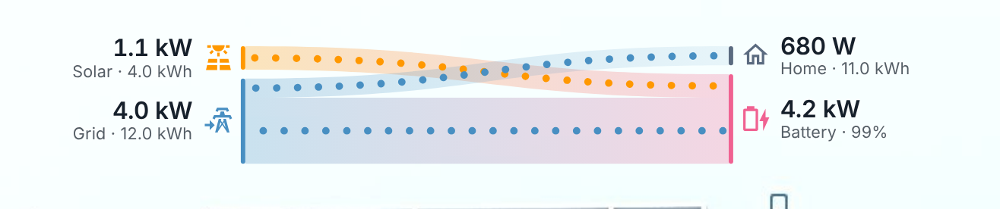
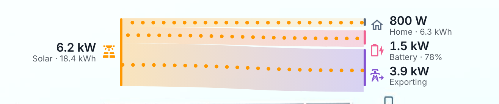
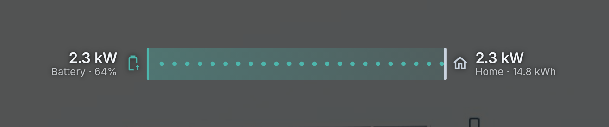

# Power Flow Strip

A slim, live power flow for Home Assistant dashboards. Where your power comes from (solar, battery, grid) is on the left, where it goes (home, battery, export) is on the right, and ribbons join them. A ribbon's thickness is its power, and particles stream along it faster as the power rises.

It has no background of its own, so it can sit straight on a floor plan or any other picture, and it switches between dark and light text with the sun to stay readable on day and night renders.





## Features

- Shows all seven possible flows: solar to home, battery and grid; grid to home and battery; battery to home and grid.
- Ribbon thickness is drawn on a fixed scale, so 500 W always looks like 500 W.
- Particle speed follows the same flow-rate model as Power Flow Card Plus, so it feels the same if you are used to that card.
- Ribbons and labels slide smoothly when the numbers change.
- Battery and grid move between the left and right sides as they switch between supplying and taking power. An idle battery still shows its state of charge.
- Set up from the dashboard's visual editor, with no YAML needed.
- Light or dark text, chosen automatically from `sun.sun` (or forced).
- Tap any label to open that sensor.
- Uses Home Assistant's energy colours, so it matches the Energy dashboard and any theme that changes them.
- Respects "reduce motion": the particles are hidden and the ribbons stay.

## Installation

### HACS

1. In Home Assistant, open **HACS**, select the three-dot menu at the top right, then **Custom repositories**.
2. Enter `https://github.com/joelsabs/HA-Power-Flow-Strip`, choose the type **Dashboard**, and select **Add**.
3. Search HACS for **Power Flow Strip**, open it and select **Download**.
4. Reload your browser (on the Android or iOS app, pull down to refresh, or clear the app's frontend cache in its settings).

HACS adds the dashboard resource for you.

### Manual

1. Copy `dist/power-flow-strip.js` to `/config/www/power-flow-strip.js`.
2. Go to **Settings → Dashboards**, open the three-dot menu, then **Resources**, and add `/local/power-flow-strip.js` with the type **JavaScript module**.
3. Reload your browser.

## Configuration

### In the dashboard editor

1. Edit your dashboard and select **Add card**.
2. Open the **By card** tab and search for **Power Flow Strip**.
3. Pick your sensors. The preview updates as you go, though at the default width you may need to scroll it sideways.

Every option below is in the editor, and changes appear straight away. Anything left at its default stays out of the saved config.

The editor works when the strip is a normal dashboard card. As an element on a picture-elements card it has to be set up in YAML; see [On a floor plan](#on-a-floor-plan-picture-elements).

### In YAML

```yaml
type: custom:power-flow-strip
entities:
  solar: sensor.solar_power
  solar_today: sensor.solar_energy_today
  battery: sensor.battery_power
  battery_soc: sensor.battery_state_of_charge
  grid: sensor.grid_power
  grid_today: sensor.grid_import_energy_today
  home: sensor.home_power
  home_today: sensor.home_energy_today
```

Power sensors can be in W or kW; the unit is read from each sensor.

### Entities

| Key | Required | What it is |
| --- | --- | --- |
| `solar` | no | Solar production power |
| `solar_today` | no | Solar energy produced today (kWh), shown under the solar value |
| `battery` | no | Battery power. See `battery_positive_is_charging` for the sign |
| `battery_soc` | no | Battery state of charge (%) |
| `grid` | no | Grid power. See `grid_positive_is_import` for the sign |
| `grid_today` | no | Energy imported from the grid today (kWh) |
| `home` | no | Home consumption power. If left out, it is worked out from the flows |
| `home_today` | no | Energy used by the home today (kWh) |

At least `entities` must be present; any sensor you leave out is treated as 0 W.

### Options

| Option | Default | What it does |
| --- | --- | --- |
| `battery_positive_is_charging` | `true` | `true` if your battery sensor is positive while charging. Set `false` if positive means discharging. (Same as `invert_state: true` in Power Flow Card Plus.) |
| `grid_positive_is_import` | `true` | `true` if your grid sensor is positive while importing |
| `zero_tolerance` | `50` | Readings at or below this many watts count as zero |
| `thresholds` | none | Hide flows to or from a source or consumer while its power is below a set number of watts. See [Thresholds](#thresholds) |
| `full_scale_power` | `6000` | Watts that fill the strip's full height. Raise it for a bigger system |
| `min_flow_rate` | `0.75` | Seconds for a particle to cross the strip at `max_expected_power` and above |
| `max_flow_rate` | `6` | Seconds for a particle to cross the strip at `min_expected_power` |
| `min_expected_power` | `0.01` | Watts |
| `max_expected_power` | `2000` | Watts |
| `mode` | `auto` | `auto` follows `night_entity`; `light` always uses dark text for light backgrounds; `dark` always uses light text |
| `night_entity` | `sun.sun` | In `auto` mode, light text is used while this entity is `below_horizon` |
| `width` | `640` | Width in pixels |
| `height` | `104` | Height in pixels |

### Thresholds

Use `thresholds` to keep small flows out of the diagram, such as a grid connection that hovers a few hundred watts either side of zero. Set a number of watts for any of `solar`, `battery`, `grid` and `home`; leave out the ones you don't need.

```yaml
thresholds:
  grid: 400     # hide grid import and export below 400 W
  battery: 100  # hide battery charging and discharging below 100 W
```

While a node's power is below its threshold, its ribbons and label are hidden. A hidden battery still shows its state of charge as idle. Exactly the threshold is still shown.

The threshold is checked against the node's total, not each ribbon, so 500 W of grid import split between the home and the battery stays visible with `grid: 400`.

Hiding doesn't change the numbers. The other labels keep their real values, so Home still shows its full use when part of it comes from a hidden grid import, and its ribbon is thinner than the number suggests by the hidden amount. If a node's only flows are hidden, its label goes too: with `grid: 400` and a house running purely on a 300 W grid import, the Home label disappears as well.

`zero_tolerance` is different: it treats a reading as zero before the flows are worked out, so the power moves to other flows rather than disappearing.

## On a floor plan (picture-elements)

Add it as an element. Positions are percentages of the picture; the strip's size is in pixels, so tune `width`, `height`, `left` and `top` for your screen.

```yaml
type: picture-elements
image: /local/floorplan/base.png
elements:
  - type: custom:power-flow-strip
    style:
      left: 1.6%
      top: 3%
      transform: none
    entities:
      solar: sensor.solar_power
      battery: sensor.battery_power
      battery_soc: sensor.battery_state_of_charge
      grid: sensor.grid_power
      home: sensor.home_power
```

`transform: none` anchors the strip by its top-left corner. Without it, picture-elements centres elements on the `left`/`top` point.

## How the flows are worked out

The same way as Power Flow Card Plus. Solar charges the battery first, then exports, and the home gets the rest. Any battery charging that solar does not cover comes from the grid, any export that solar does not cover comes from the battery, and the home's remaining use comes from the grid and then the battery.

## Credits

Inspired by [Power Flow Card Plus](https://github.com/flixlix/power-flow-card-plus) by flixlix: the flow split, particle-speed model and colours follow that card. The layout and code here are new.

## Licence

MIT
